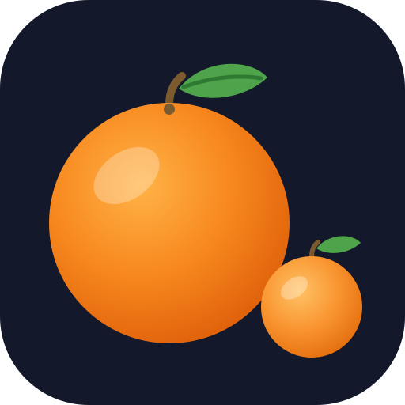

<p align="center"></p>

<h1 align="center">Mikan</h1>

<p align="center"><b>Small language models that do one job as well as a large one, with the statistics to prove it.</b></p>

Many real uses of large language models are narrow and repetitive: sorting a support message, tagging an intent,
filling a form from a sentence. Mikan distils a large model's behaviour on tasks like these into compact open models
(0.6B to 4B parameters) that are far cheaper and faster to run, and holds every model to a statistical test against
its teacher, with the pass mark fixed before training begins.

This repository is the pipeline behind it: data preparation, teacher labelling, fine-tuning with LoRA and GRPO, and
the evaluation that decides whether a small model is good enough. Trained models and datasets are published by
[Mikan Research on Hugging Face](https://huggingface.co/mikan-research).

## Getting started

Requires Python 3.11+ and [uv](https://docs.astral.sh/uv/).

```bash
git clone https://github.com/mikan-research/mikan && cd mikan
uv sync
uv run pytest -q
```

Evaluation runs on a laptop; training runs on a single 16 GB GPU such as a free Kaggle or Colab T4. To reproduce a
published result without a GPU, follow [getting started](docs/getting-started.md).

## Documentation

- [Getting started](docs/getting-started.md): reproduce a published result in a few minutes
- [Training](docs/training.md): label data with a teacher and train small models
- [Adding a task](docs/adding-a-task.md): bring your own task and evaluation
- [Reference](docs/reference.md): commands, configs and file formats
- [Evaluation method](docs/evaluation.md) and [pipeline](docs/pipeline.md): how and why it works

## Get involved

New tasks, models and evaluations are all welcome, as are honest negative results. Read the
[contributing guide](CONTRIBUTING.md) to get started; everyone taking part follows the
[code of conduct](CODE_OF_CONDUCT.md). Questions or ideas: [mikan.research@gmail.com](mailto:mikan.research@gmail.com).

## Licence

Code is released under [Apache-2.0](LICENSE). Published models are Apache-2.0 and datasets CC-BY-4.0, crediting
their original sources.
